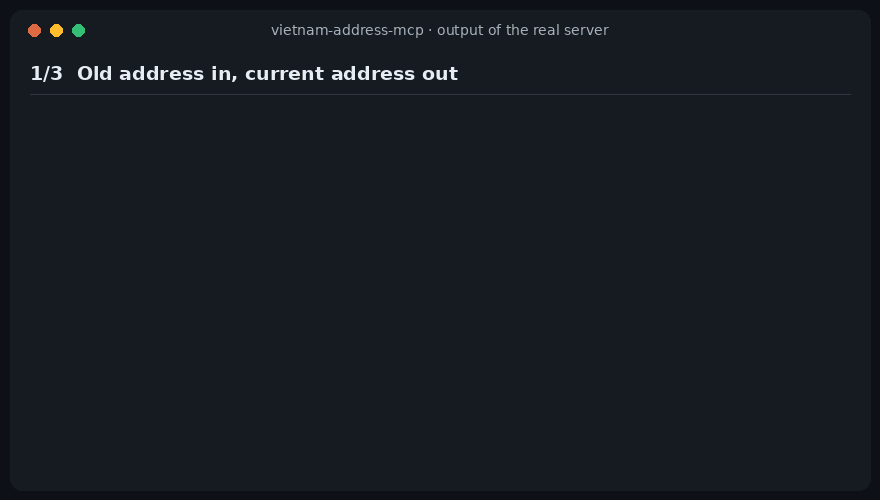

<div align="center">


# vietnam-address-mcp

**Convert old Vietnamese addresses to the new 34-province structure — straight from your AI assistant.**<br>
*Đổi địa chỉ cũ sang đơn vị hành chính mới (sau sáp nhập tỉnh, bỏ cấp huyện) ngay trong Claude, Cursor, VS Code…*

[](https://github.com/amItuff/vietnam-address-mcp/actions/workflows/ci.yml)
[](LICENSE)
[](https://modelcontextprotocol.io)

[Tiếng Việt](README.vi.md) · [English](README.md)



<sub>The animation is drawn from the real server's output (<a href="demo/capture.mjs">demo/capture.mjs</a>), not typed by hand.</sub>

</div>

## Why

Since 1 July 2025 Vietnam has 34 provinces and 3,321 wards/communes, and the district level is gone.
Addresses in your CRM, order forms and shipping data still use the old 63-province, 3-level format.

Mapping them is not something a language model can do reliably from memory: there are 10,040 old
units, 471 of them were split between several new wards, and names such as "Phường 1" exist in many
districts. This server answers from data instead, and says so when the answer is uncertain.

## Install

Requires Node.js 20+. No network access or API key is needed at runtime.

**Claude Code**

```bash
claude mcp add vietnam-address -- npx -y vietnam-address-mcp
```

**Claude Desktop, Cursor, VS Code, any MCP client** — add to the client's MCP config:

```json
{
  "mcpServers": {
    "vietnam-address": {
      "command": "npx",
      "args": ["-y", "vietnam-address-mcp"]
    }
  }
}
```

**From source**

```bash
git clone https://github.com/amItuff/vietnam-address-mcp.git
cd vietnam-address-mcp
npm ci && npm run build
# then point your client at:  node /absolute/path/to/vietnam-address-mcp/dist/index.js
```

## Tools

| Tool | Use it to |
| --- | --- |
| `normalize_address` | Turn a free-text address, **old or new format**, into the current structure. Keeps the street. |
| `convert_legacy_address` | Convert an old address that is already split into `province` / `district` / `ward` (e.g. database columns). |
| `search_units` | Look up provinces and wards by name. `scope: "legacy"` searches old units and shows where each maps today. |

Try asking your assistant: *"Chuẩn hóa địa chỉ: 12 Lê Lợi, Phường Bến Nghé, Quận 1, TP.HCM"*.

<details>
<summary>Example response of <code>normalize_address</code></summary>

```json
{
  "status": "ok",
  "inputFormat": "legacy",
  "confidence": "exact",
  "street": "12 Lê Lợi",
  "address": {
    "ward": { "code": "26740", "fullName": "Phường Sài Gòn" },
    "province": { "code": "79", "fullName": "Thành phố Hồ Chí Minh" },
    "formatted": "Phường Sài Gòn, Thành phố Hồ Chí Minh",
    "formattedWithStreet": "12 Lê Lợi, Phường Sài Gòn, Thành phố Hồ Chí Minh"
  },
  "from": {
    "province": { "code": "79", "fullName": "Thành phố Hồ Chí Minh" },
    "district": { "code": "760", "fullName": "Quận 1" },
    "ward": { "code": "26740", "fullName": "Phường Bến Nghé" },
    "formatted": "Phường Bến Nghé, Quận 1, Thành phố Hồ Chí Minh"
  },
  "notes": []
}
```

</details>

### How uncertainty is reported

Every response carries a `status` and, when it succeeded, a `confidence`. Assistants are instructed to
surface these instead of hiding them.

| Result | Meaning |
| --- | --- |
| `status: "ok"`, `confidence: "exact"` | Every level matched uniquely. |
| `confidence: "split_default"` | The old ward was **divided** between several new wards. A default is returned together with all `alternatives`; the default is a heuristic. |
| `confidence: "inferred"` | The district was missing, but the ward name is unique in the province. |
| `status: "ambiguous"` | The input matches several units (e.g. "Phường 1" with no district). `candidates` lists them; nothing is guessed. |
| `status: "not_found"` | No match. `didYouMean` offers suggestions from the same province. |

Also handled: missing diacritics, abbreviations (`P.`, `Q.`, `TP.HCM`), a street glued to the ward,
units whose type changed (`Xã Bố Hạ` → `Phường Bố Hạ`), and names that differ only by diacritics
(`Văn Lang` / `Văn Lăng`).

## Limitations

Read these before relying on the output.

- **Old → new only.** The reverse direction is genuinely one-to-many and is not implemented.
- **Divided wards are heuristic.** 471 of 10,040 old units (~4.7%) were split. The default target was
  chosen upstream by comparing the old ward's geocoded centre point with the new boundaries. It is a
  sensible guess, not a legal determination — confirm with the street or the official resolution.
- **Names only.** There is no street-level data and no geocoding.
- **Comma-separated input.** Components must be separated by commas (a street glued to the ward is the one exception).
- **Old-ward coverage.** The old list is the General Statistics Office catalogue of mid-2025. Wards that
  were merged or renamed before that and are missing from it may return `not_found` with suggestions.
- **Data freshness.** New-unit names and codes are current through Resolution 388/NQ-UBTVQH16
  (effective 2026-09-20). Later changes need a data update (see [CONTRIBUTING](CONTRIBUTING.md)).
- Not legal advice. For contracts and official filings, check the resolutions.

## Data and licensing

The server is **offline** and ships its dataset (`data/`, about 2.2 MB), generated by
[`scripts/build-data.mjs`](scripts/build-data.mjs) from two MIT-licensed projects pinned to exact commits:

| Source | Provides |
| --- | --- |
| [thanglequoc/vietnamese-provinces-database](https://github.com/thanglequoc/vietnamese-provinces-database) | Current provinces and wards (codes, names) |
| [tranngocminhhieu/vietnamadminunits](https://github.com/tranngocminhhieu/vietnamadminunits) | Old ward list and the old → new mapping |

The build validates hard invariants (34 provinces, 3,321 wards, every mapping target exists, every
divided ward has exactly one default, every new ward is reachable) and CI rebuilds the data from the
pinned commits and fails if the committed files differ. Details and attribution: [NOTICE.md](NOTICE.md).

If you only need a library rather than an MCP server, see the Python package
[vietnamadminunits](https://github.com/tranngocminhhieu/vietnamadminunits), whose data this project builds on.

## Development

```bash
npm ci
npm run typecheck && npm test   # Node >= 22 for the tests
npm run build && node scripts/smoke.mjs
```

The test suite includes round trips over **every** unit in the dataset (each old ward written out in
full must convert to one of its own targets; each new ward must resolve to itself), plus golden cases
cross-checked against Resolution 1685/NQ-UBTVQH15. See [CONTRIBUTING.md](CONTRIBUTING.md).

## License

[MIT](LICENSE). Third-party data notices are in [NOTICE.md](NOTICE.md).
