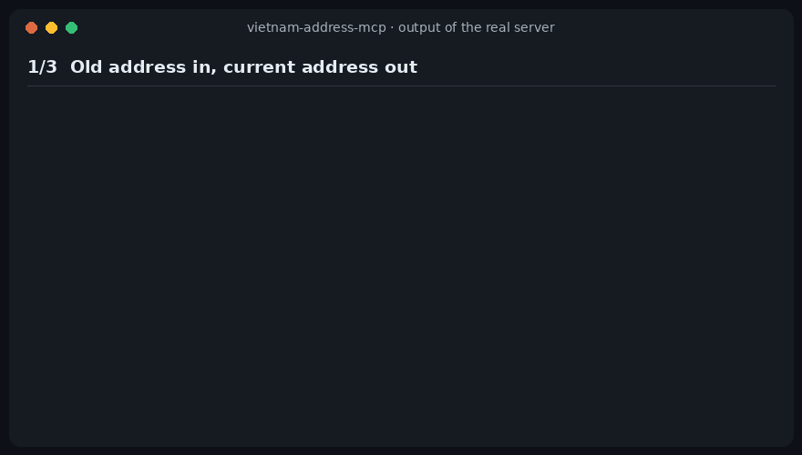

<div align="center">


# vietnam-address-mcp

**Đổi địa chỉ cũ sang đơn vị hành chính mới (34 tỉnh, bỏ cấp huyện) ngay trong trợ lý AI.**<br>
*Convert old Vietnamese addresses to the new 34-province structure.*

[](https://github.com/amItuff/vietnam-address-mcp/actions/workflows/ci.yml)
[](LICENSE)
[](https://modelcontextprotocol.io)

[Tiếng Việt](README.vi.md) · [English](README.md)



<sub>Ảnh động được vẽ từ output thật của server (<a href="demo/capture.mjs">demo/capture.mjs</a>), không gõ tay.</sub>

</div>

## Vì sao cần

Từ 1/7/2025, Việt Nam còn 34 tỉnh/thành và 3.321 xã/phường/đặc khu, không còn cấp huyện.
Địa chỉ trong CRM, form đặt hàng, dữ liệu giao vận… vẫn là dạng cũ (63 tỉnh, 3 cấp).

Mô hình ngôn ngữ không thể nhớ chính xác phép ánh xạ này: có 10.040 đơn vị cũ, 471 đơn vị trong đó bị
chia cho nhiều phường/xã mới, và những tên như "Phường 1" tồn tại ở rất nhiều quận. Server này trả lời
bằng dữ liệu tra cứu, và nói rõ khi kết quả không chắc chắn.

## Cài đặt

Cần Node.js 20+. Chạy hoàn toàn offline, không cần API key.

**Claude Code**

```bash
claude mcp add vietnam-address -- npx -y vietnam-address-mcp
```

**Claude Desktop, Cursor, VS Code, mọi MCP client** — thêm vào cấu hình MCP:

```json
{
  "mcpServers": {
    "vietnam-address": {
      "command": "npx",
      "args": ["-y", "vietnam-address-mcp"]
    }
  }
}
```

**Từ mã nguồn**

```bash
git clone https://github.com/amItuff/vietnam-address-mcp.git
cd vietnam-address-mcp
npm ci && npm run build
# rồi trỏ client tới:  node /duong/dan/tuyet/doi/vietnam-address-mcp/dist/index.js
```

## Các tool

| Tool | Dùng để |
| --- | --- |
| `normalize_address` | Chuẩn hóa địa chỉ viết tự do, **dạng cũ hoặc mới**, về cấu trúc hiện hành. Giữ nguyên số nhà/đường. |
| `normalize_addresses` | Bản hàng loạt, tối đa 200 địa chỉ (một cột trong bảng tính), kèm thống kê ok / mơ hồ / không tìm thấy. |
| `convert_legacy_address` | Đổi địa chỉ cũ đã tách sẵn `province` / `district` / `ward` (ví dụ các cột trong database). |
| `search_units` | Tra tỉnh/xã theo tên. `scope: "legacy"` tra đơn vị cũ và cho biết hiện nay thuộc đơn vị nào. |

Mọi kết quả đều có `dataVersion` (`currentThrough` và `effectiveDate`) để biết dữ liệu theo căn cứ pháp lý nào.
Hiện là **Nghị quyết 388/NQ-UBTVQH16, hiệu lực 20/9/2026**.

### Bảng tính (CSV)

Không cần MCP client để xử lý một file địa chỉ:

```bash
npx -y vietnam-address-mcp csv khach-hang.csv --column address --output khach-hang.moi.csv
```

Giữ nguyên các cột gốc và thêm `new_address`, `address_status`, `address_confidence`, `address_note`.
Lọc theo `address_status` (`ok`, `ambiguous`, `not_found`) và `address_confidence = split_default` để xem
các dòng cần người kiểm tra. Tự nhận dấu phẩy, chấm phẩy, tab (đổi bằng `--delimiter`).

Thử hỏi trợ lý: *"Chuẩn hóa địa chỉ: 12 Lê Lợi, Phường Bến Nghé, Quận 1, TP.HCM"*.

### Cách báo mức độ chắc chắn

| Kết quả | Ý nghĩa |
| --- | --- |
| `status: "ok"`, `confidence: "exact"` | Mọi cấp khớp duy nhất. |
| `confidence: "split_default"` | Xã/phường cũ **bị chia** cho nhiều đơn vị mới. Trả về mặc định kèm đủ `alternatives`; mặc định chỉ là heuristic. |
| `confidence: "inferred"` | Thiếu quận/huyện nhưng tên xã là duy nhất trong tỉnh. |
| `status: "ambiguous"` | Đầu vào khớp nhiều đơn vị (ví dụ "Phường 1" không kèm quận). `candidates` liệt kê, không đoán. |
| `status: "not_found"` | Không khớp. `didYouMean` gợi ý trong cùng tỉnh. |

Cũng xử lý được: thiếu dấu, viết tắt (`P.`, `Q.`, `TP.HCM`), số nhà dính liền tên phường, đơn vị đổi loại
(`Xã Bố Hạ` → `Phường Bố Hạ`), và các tên chỉ khác nhau ở dấu (`Văn Lang` / `Văn Lăng`).

## Giới hạn

Hãy đọc trước khi dựa vào kết quả.

- **Chỉ cũ → mới.** Chiều ngược lại thực chất là một-nhiều nên chưa hỗ trợ.
- **Xã bị chia chỉ là heuristic.** 471/10.040 đơn vị cũ (~4,7%) bị chia. Đích mặc định do dự án nguồn chọn bằng cách
  so điểm tâm (geocode) của xã cũ với ranh giới xã mới. Đó là phỏng đoán hợp lý, không phải xác định pháp lý —
  hãy xác nhận bằng tên đường hoặc nghị quyết.
- **Chỉ theo tên.** Không có dữ liệu mức đường phố, không geocode.
- **Phải ngăn cách bằng dấu phẩy** (trừ trường hợp số nhà dính liền tên phường).
- **Độ phủ đơn vị cũ.** Danh sách cũ là danh mục của Cục Thống kê giữa năm 2025. Xã đã sáp nhập/đổi tên trước đó mà
  không có trong danh mục có thể trả về `not_found` kèm gợi ý.
- **Độ mới của dữ liệu.** Tên và mã đơn vị mới cập nhật đến Nghị quyết 388/NQ-UBTVQH16 (hiệu lực 20/09/2026).
  Thay đổi sau đó cần cập nhật dữ liệu (xem [CONTRIBUTING](CONTRIBUTING.md)).
- Không phải tư vấn pháp lý. Với hợp đồng và hồ sơ chính thức, hãy đối chiếu nghị quyết.

## Dữ liệu và giấy phép

Server chạy **offline**, đóng gói sẵn dữ liệu (`data/`, khoảng 2,2 MB), được sinh bởi
[`scripts/build-data.mjs`](scripts/build-data.mjs) từ hai dự án MIT, ghim theo commit cụ thể:

| Nguồn | Cung cấp |
| --- | --- |
| [thanglequoc/vietnamese-provinces-database](https://github.com/thanglequoc/vietnamese-provinces-database) | Tỉnh/xã hiện hành (mã, tên) |
| [tranngocminhhieu/vietnamadminunits](https://github.com/tranngocminhhieu/vietnamadminunits) | Danh sách xã cũ và ánh xạ cũ → mới |

Quá trình build kiểm tra cứng các ràng buộc (34 tỉnh, 3.321 xã, mọi đích ánh xạ tồn tại, mỗi xã bị chia có đúng một
mặc định, mọi xã mới đều có nguồn). CI dựng lại dữ liệu từ commit đã ghim và báo lỗi nếu khác bản đã commit.
Chi tiết ghi công: [NOTICE.md](NOTICE.md).

Nếu bạn chỉ cần thư viện chứ không cần MCP server, xem gói Python
[vietnamadminunits](https://github.com/tranngocminhhieu/vietnamadminunits) — dữ liệu của dự án này dựa trên đó.

## Phát triển

```bash
npm ci
npm run typecheck && npm test   # test cần Node >= 22
npm run build && node scripts/smoke.mjs
```

Bộ test gồm kiểm tra vòng khứ hồi trên **toàn bộ** đơn vị (mỗi xã cũ viết đầy đủ phải đổi về một trong các đích của
nó; mỗi xã mới phải tra ra chính nó), cùng các ca vàng đối chiếu với Nghị quyết 1685/NQ-UBTVQH15.
Xem [CONTRIBUTING.md](CONTRIBUTING.md).

## Giấy phép

[MIT](LICENSE). Thông báo về dữ liệu bên thứ ba ở [NOTICE.md](NOTICE.md).
